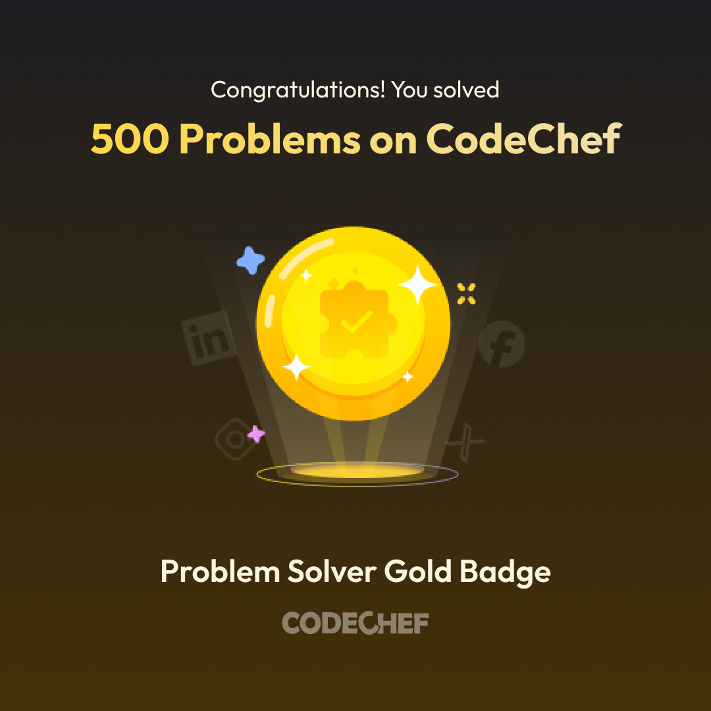
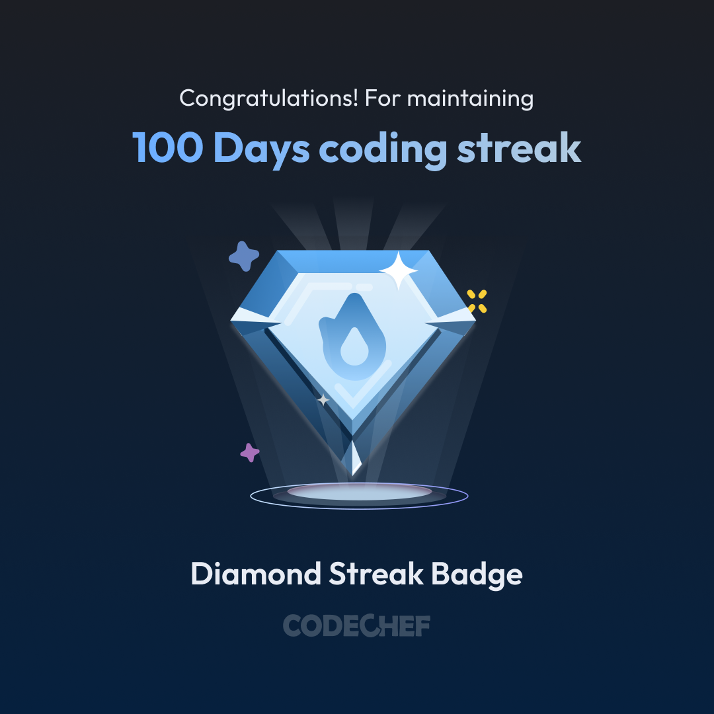
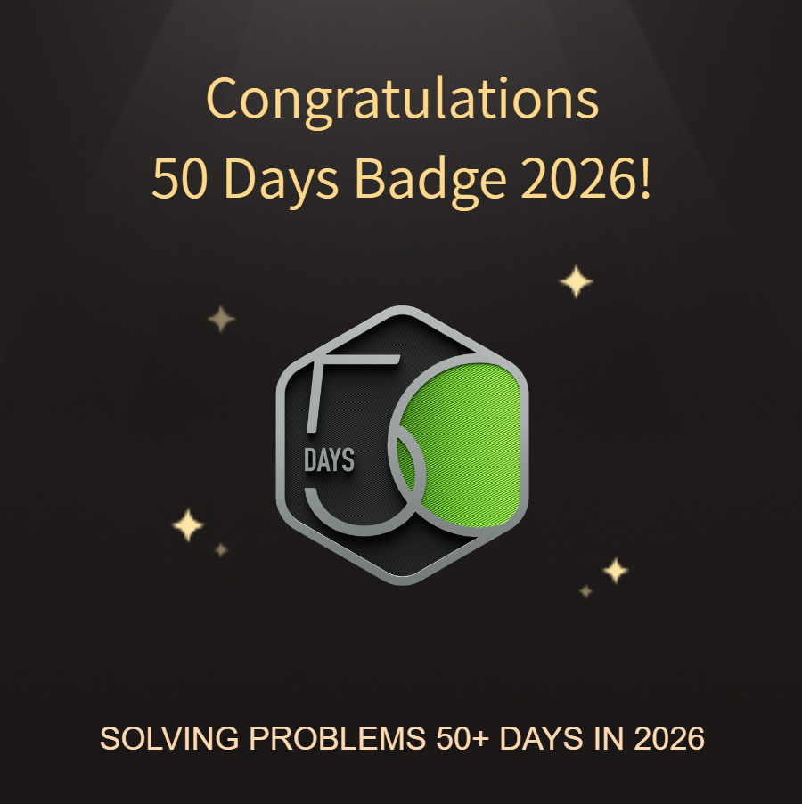
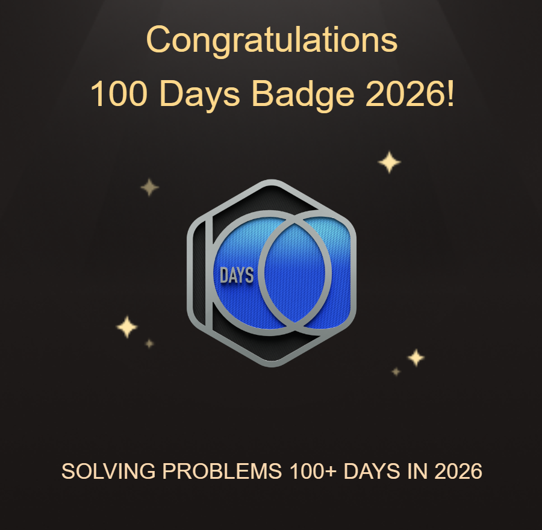

 <div align="center">


<p>
<a href="https://linkedin.com/in/sowndaryar"></a>
<a href="https://portfolio-alpha-gules-75.vercel.app/"></a>
<a href="mailto:kit28.24cs165@gmail.com"></a>
<a href="https://leetcode.com/u/Kitcs165/"></a>
<a href="https://www.codechef.com/users/kit28csa165"></a>
</p>

<p>


</p>

</div>

---

## 👩‍💻 About Me

```ts
const sowndarya = {
  name: "Sowndarya R",
  role: "Full Stack Developer (MERN)",
  education: "B.E. CSE @ KIT, Coimbatore",
  graduation: "2028",
  cgpa: "8.5/10",
  experience: [
    "Backend Developer Intern @ Clar Technologies",
    "Data Analytics Intern @ Appin Technology",
    "Infosys Springboard Virtual Internship"
  ],
  skills: [
    "Java",
    "JavaScript",
    "React",
    "Node.js",
    "Express.js",
    "MongoDB",
    "SQL",
    "Python"
  ],
  interests: [
    "Full Stack Development",
    "Data Analytics",
    "AI/ML",
    "Data Structures & Algorithms"
  ],
  achievements: [
    "LeetCode 100 Days Badge",
    "IEEE Member",
    "2nd Prize in Coding Events",
    "DevJams Hackathon Finalist"
  ],
  motto: "Learn. Build. Debug. Repeat."
};
```

- 🎓 Third-year Computer Science and Engineering student at **KIT, Coimbatore**.
- 💻 Passionate about building scalable full-stack applications using the MERN stack.
- 💼 Backend Developer Intern at **Clar Technologies**.
- 📊 Data Analytics Intern at **Appin Technology**.
- 🚀 Currently participating in the **Infosys Springboard Virtual Internship**.
- 🌐 **IEEE Member**, interested in technology, innovation, and continuous learning.
- 🧠 Built an AI-based SMS Spam Detector using xLSTM, achieving **95.94% test accuracy**.
- 🧩 Solved **1,159 coding problems** across competitive programming platforms.
- 🔥 Earned the **LeetCode 100 Days Badge**.
- 🗣️ Languages: Tamil and English.
- 📫 Email: **kit28.24cs165@gmail.com**

---

## 🎓 Education

| Degree | Institution | Duration | CGPA |
|---|---|---|---|
| B.E. Computer Science and Engineering | KIT — Kalaignarkarunanidhi Institute of Technology, Coimbatore | 2024–2028 | 8.5/10 |

**Relevant Coursework:** Data Structures and Algorithms · Object-Oriented Programming · DBMS · Operating Systems · Software Development

---

## 🛠️ Tech Stack

### ⚡ Programming Languages


### 🎨 Frontend Development


### 🔧 Backend & Database


### 📊 Data Analytics & Machine Learning


### 🔩 Tools & Platforms


### 🧠 DSA Focus Areas


---

## 🏅 Coding Achievements

<p align="center">
  
  
</p>

<p align="center">
   
  
</p>

---

## 💻 Competitive Programming

<p align="center">
  
  
  
</p>

| Platform | Rating | Contests |
|---|---:|---:|
| 🟡 LeetCode | 1,456 reported | 30 |
| 🟤 CodeChef | 1,106 max | 57 |
| 🔵 Codeforces | 821 max | 4 |
| 🟠 CodeChef DSA Challenge | 1,456 reported | 15 |

**Achievements**
- 🏅 LeetCode 100 Days Badge
- 🔥 Diamond Badge and Golden Badge
- 🧩 1,159 coding problems solved
- 📅 342 active days
- 🏆 106 contests attended

**Question Distribution — Codolio**

| Category | Count |
|---|---:|
| Fundamentals | 22 |
| DSA | 364 |
| Competitive Programming | 773 |
| **Total** | **1,159** |

<p align="center">
  <a href="https://codolio.com/profile/Kit28.bcs165">
    
  </a>
  <a href="https://leetcode.com/u/Kitcs165/">
    
  </a>
  <a href="https://www.codechef.com/users/kit28csa165">
    
  </a>
</p>

### 🟡 LeetCode Live Stats

<p align="center">
  
</p>
---

## 🚀 Featured Projects

### 🤖 AI-Based SMS Spam Detection Using xLSTM

Developed an AI-based SMS classification model using a hybrid mLSTM and sLSTM architecture to distinguish legitimate messages from spam.

- Applied NLP preprocessing and 128-dimensional embeddings.
- Evaluated the model using accuracy, precision, recall, F1-score, and a confusion matrix.
- Achieved **95.94% test accuracy**.

**Tech Stack:** Python · PyTorch · NLP · scikit-learn

[**View Repository →**](https://github.com/SOWNDARYA-R7/SMS_Spam_detection_in_xLSTM)

### 🌐 CareerHub — Career Resources & Opportunity Platform

A full-stack platform designed to help users explore career-related information in one place, including technology news, learning resources, and internship opportunities.

- 📰 **News:** Access career and technology-related news.
- 📚 **Learning Resources:** Discover resources to improve technical skills.
- 💼 **Internships:** Retrieve internship opportunities through SerpApi integration.
- ⚡ **Caching:** Uses MongoDB TTL-based caching to store internship results for 24 hours.
- 🔄 **Fresh Results:** Fetches updated internship data when the cache expires.

**Tech Stack:** MERN Stack · MongoDB · Express.js · React · Node.js · SerpApi

**Repository:** Add your CareerHub GitHub repository link here.

### 🎨 Digital Art Gallery Web Application

A responsive full-stack application for managing digital artwork, featuring user authentication and CRUD operations.

- Built a React frontend connected to a Node.js backend.
- Integrated MongoDB for artwork data management.
- Implemented RESTful APIs for application operations.

**Tech Stack:** React · Node.js · Express.js · MongoDB

[**View Repository →**](https://github.com/SOWNDARYA-R7/Digital_Art_Gallery_App)

---

## 💼 Experience & Internship

### Backend Developer Intern — Clar Technologies
*Coimbatore · June 2026*

- Developed and maintained RESTful APIs using Node.js and Express.js.
- Designed MongoDB schemas and implemented CRUD operations.
- Collaborated in an Agile environment involving sprint planning, stand-ups, and peer code reviews.

### Data Analytics Intern — Appin Technology
*One-month internship*

- Explored Power BI, Power Query, DAX measures, and dashboard development.
- Analyzed sales data to identify trends and build interactive dashboards.

### Infosys Springboard Virtual Internship
*Currently participating*

- Currently undertaking the Infosys Springboard Virtual Internship.
- Applying technical knowledge to project-based learning and software development activities.

---

## 🏆 Achievements & Certifications

| Category | Achievement |
|---|---|
| 🥈 Competition | Second Prize — Code Debugging @ KGiSL |
| 🥈 Competition | Second Prize — Treasure Hunt Coding @ SREC |
| 🏁 Hackathon | Finalist — DevJams 48-hour Hackathon @ VIT |
| 🎯 Internship | Shortlisted — Infosys Springboard Virtual Internship |
| 💻 Coding | LeetCode 100 Days Badge |
| 🔥 Coding | Diamond Badge and Golden Badge |
| 🌐 Membership | IEEE Member |
| 📜 Certification | NPTEL — Problem Solving Through Programming in C (2025) |
| 📜 Certification | Novi-Tech — Full Stack Development (2025) |
| 📜 Certification | Infosys — Java Foundation (2026) |
| 📜 Certification | Cisco — Python Essentials 1 (2026) |
| 📜 Certification | TeamEverest — Decision Making (2026) |

---

## 🎯 What I'm Working On

| Area | Focus |
|---|---|
| 🔨 Building | Full-stack MERN applications with clean architecture |
| 🌐 Developing | CareerHub — news, learning resources, and internship discovery |
| 📐 Learning | System Design and scalable backend development |
| 🤖 Exploring | AI/ML integration, NLP, and deep learning |
| 📈 Practicing | Daily DSA and competitive programming |
| 🌍 Growing | Open-source collaboration and continuous learning |

---

## 🤝 Let's Connect

I'm interested in software development, AI/ML, data analytics, and building practical technology solutions. I'm open to collaborating on meaningful projects and exploring internship opportunities.

<p align="center">
<a href="https://linkedin.com/in/sowndaryar"></a>
<a href="mailto:kit28.24cs165@gmail.com"></a>
<a href="https://github.com/SOWNDARYA-R7"></a>
<a href="https://portfolio-alpha-gules-75.vercel.app/"></a>
</p>

---

<div align="center">

### 🙏 Thank You for Visiting!

If you find my work interesting, feel free to explore my repositories and leave a ⭐.

*Every line of code is a step forward. Keep building. Keep growing. 🚀*

</div>
